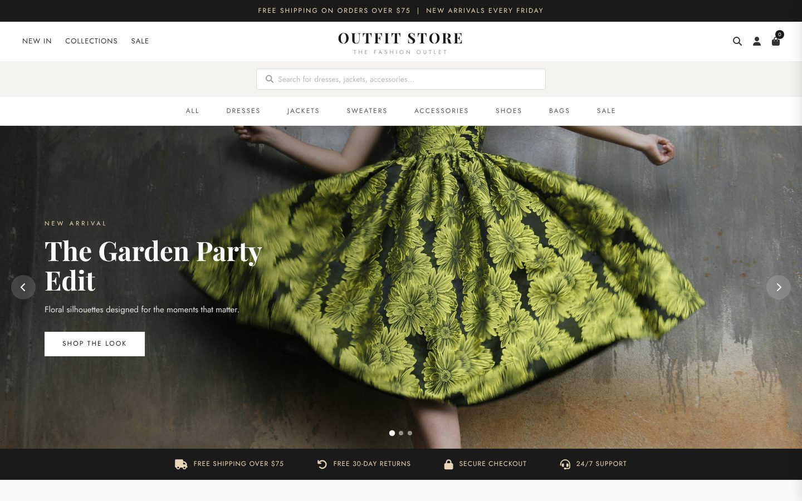

# Outfit Store — Fashion E-Commerce Website

A responsive storefront for a fashion boutique, built with plain HTML, CSS and JavaScript.

**Live demo:** https://mostafa-habib365.github.io/E-commerce-website/



## Features

- Hero slideshow with arrows, dots and auto-play
- Product search bar and category navigation (dresses, jackets, accessories and more)
- Working cart drawer: add, remove and change quantities
- Wishlist toggle and toast notifications
- Newsletter sign-up
- Responsive layout for phones and desktops

## Built with

HTML · CSS · JavaScript · Font Awesome · Google Fonts

## Run it locally

Open `index.html` in a browser, or serve the folder:

```bash
python3 -m http.server
```

---

Built by [Mostafa Habib](https://mostafa-habib.y98d7h5mkk.workers.dev/) — secure, fast websites for small businesses.
